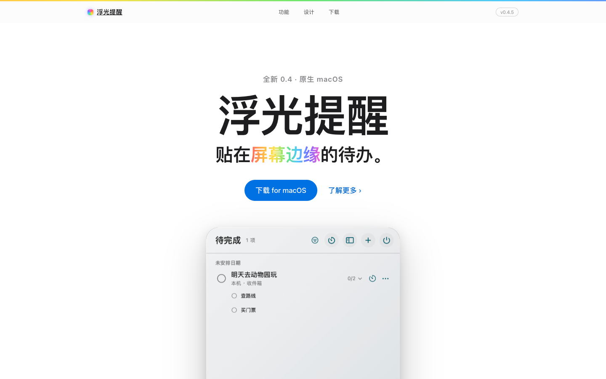
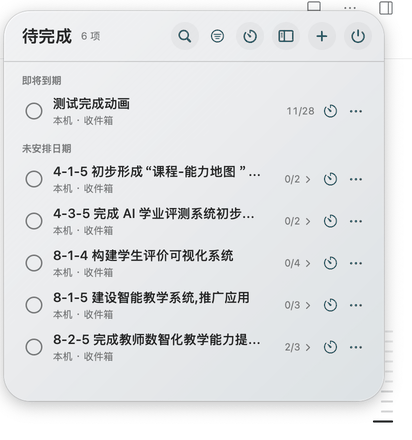
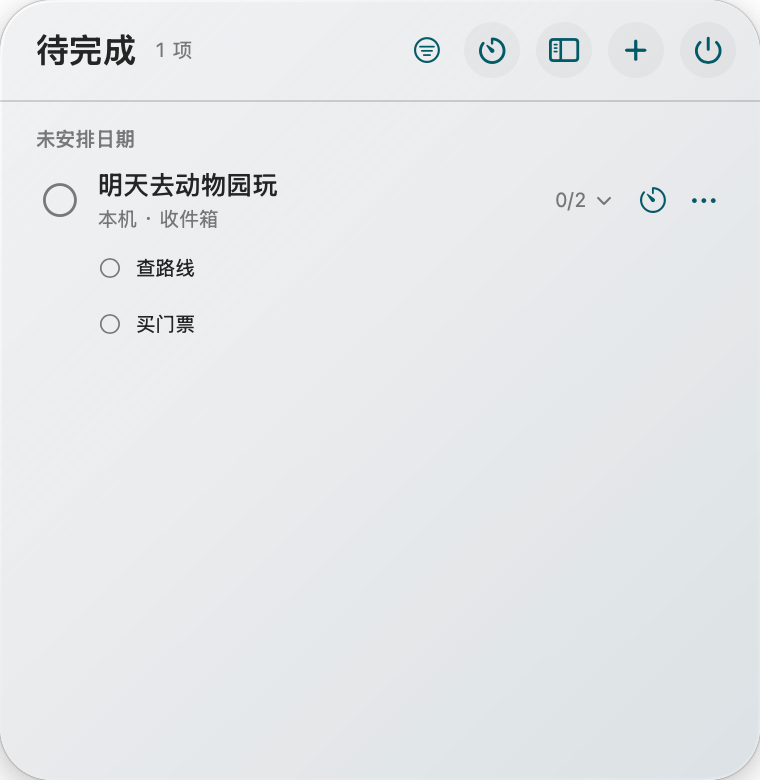
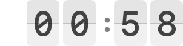
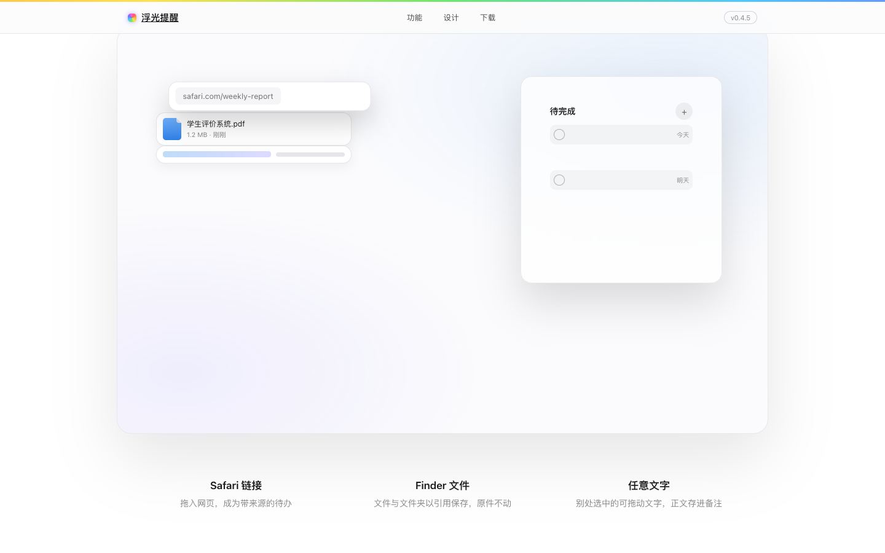

# 浮光提醒 · EdgeReminders

一个常驻屏幕边缘的原生 macOS 提醒事项应用。把 Apple 提醒事项和本机待办放进同一个浮窗：贴边收起、鼠标唤出，拖放收集资料，拆分子任务，专注计时。所有数据都在你自己的 Mac 和 iCloud 里。

[](https://github.com/giracle/EdgeReminders/releases)
[](https://github.com/giracle/EdgeReminders/releases)
[](LICENSE)
[](https://github.com/giracle/EdgeReminders/releases)





## 为什么做它

提醒事项类应用不缺，缺的是「不打断你」的那种。浮光提醒把待办做成一片可以贴在屏幕边缘的玻璃：需要时滑出，处理完收起，不会在你写代码、写文档的时候抢走一个窗口。它同时管 Apple 提醒事项和本机清单，拖进去的网页、文件、文字会自动变成待办。

- **贴边不打扰**：拖到屏幕任意边缘收起，鼠标停留即展开。
- **收集零摩擦**：拖放、剪贴板、命令行、快捷指令、本地 HTTP 五个入口。
- **计划有结构**：标签、前置依赖、智能清单、自然语言搜索、撤销重做。
- **专注可回看**：专注计时带日志和统计，计时浮窗下方有呼吸氛围光。
- **数据自己拿**：CSV / Markdown / JSON 导出，整库备份与恢复，可手动同步到自己的 iCloud。

## 功能

### 浮窗与视觉

- 玻璃浮窗贴边动画，多显示器相邻边界不会误触。
- 五种主题色（浮光青 / 深海蓝 / 暖阳橙 / 暮山紫 / 胭脂粉），面板透明度可调。
- 完成事项时的小粒子庆祝（可关）、可选的彩虹细线。
- 计时窗口翻牌数字，专注运行时背景有缓慢呼吸的氛围光。
- macOS 26 使用原生 Liquid Glass，macOS 15 使用系统半透明材质，遵循「减少动态效果」。

### 收集输入

| 入口 | 用法 |
| --- | --- |
| 拖放 | 把链接、文件、文字拖到浮窗或屏幕边缘 |
| 剪贴板 | 开启后复制文本/链接自动进收件箱（可在设置关闭） |
| 全局快捷键 | `Control + Shift + N` 唤起新增 |
| 命令行 | `er add "明天十点交周报"` |
| 本地 HTTP | `POST http://127.0.0.1:8742/inbox` |
| 快捷指令 / Siri | 「把……记到浮光提醒」 |

### 计划

- 本机清单与 Apple 提醒事项统一管理，可写清单里新增、编辑、勾选。
- 子任务：进度展开勾选、模板、拖动排序；全部勾完可一键完成父事项。
- 标签（`#工作 #面试`）与前置依赖：未满足前置的事项显示阻塞标记。
- 智能清单：按标签、优先级、逾期、N 天内到期、无日期、清单自动聚合，可自定义规则。
- 自然语言搜索：`#面试`、`明天`、`紧急`、关键词混着打。
- 即将到期视图（14 天分组）、归档、批量选择、撤销 / 重做。
- 重复事项：每天 / 每周 / 每月 / 每年 / 自定义。

### 专注

- 专注计时（番茄式）与普通倒计时，1–180 分钟。
- 计时日志自动记录：近 7 天专注时长与轮数、累计时长、活跃天数。
- 从待办直接开始计时，结束自动回到事项；「继续」会同时打开关联资料。

### 同步

- 手动 CloudKit 同步：把本机清单整包推送到自己的私有 iCloud 数据库，另一台 Mac 拉回恢复。
- 冲突策略为最后写入获胜，界面上会显示上次同步时间。

### 智能（Pro）

- AI 拆子任务：在事项详情点「AI 拆解」，模型返回 2–6 条可执行步骤。
- AI 周报：统计页一键生成本周简报（任务 + 专注数据）。
- 支持任意 OpenAI 兼容接口：OpenAI、DeepSeek、Ollama 等；Key 保存在系统钥匙串。

### 数据与集成

- 导出 CSV / Markdown / JSON；整库备份与恢复（`.json` 备份，可跨设备）。
- 统计页：近 14 天完成柱状图、待办/已完成/逾期/连续完成、按清单与标签分布。
- 一键把事项写入 Apple 日历（1 小时事件 + 到点提醒）。
- 检查更新：从 GitHub Releases 拉取最新版本，可在设置里关闭。

## 安装

需要 **macOS 15 或更高版本**，通用安装包同时支持 Apple 芯片和 Intel。

**方式一：安装包**（推荐）

1. 从 [GitHub Releases](https://github.com/giracle/EdgeReminders/releases) 下载 `EdgeReminders-<版本>-macOS-universal.dmg`。
2. 打开镜像，把 `EdgeReminders.app` 拖到「应用程序」，再从应用程序文件夹启动。
3. 点击浮窗右上角「打开清单」开始配置；需要读取现有清单时连接 Apple 提醒事项。

**方式二：Homebrew**

```sh
brew install --cask giracle/tap/edge-reminders
```

暂时还没有官方 tap 收录，也可以下载仓库里的 `Homebrew/EdgeReminders.rb` 后本地安装：

```sh
brew install --cask ./Homebrew/EdgeReminders.rb
```

**方式三：命令行工具 er**

安装镜像里附带 `er` 可执行文件；运行镜像中的「安装命令行工具.command」即可装到 `/usr/local/bin/er`。也可以从源码构建：

```sh
xcodebuild -project EdgeReminders.xcodeproj -target er -configuration Release SYMROOT="$PWD/build/er" build
sudo cp build/er/Release/er /usr/local/bin/er
```

> 测试版采用临时签名，尚未 Apple 公证，首次启动可能被 macOS 拦截。可在「系统设置 → 隐私与安全性」里选择「仍要打开」，或运行 `xattr -dr com.apple.quarantine /Applications/EdgeReminders.app`。镜像校验：`shasum -a 256 -c EdgeReminders-<版本>-macOS-universal.dmg.sha256`。

## 截图

| 浮窗 | 计时 |
| --- | --- |
|  |  |

| 管理清单 | 拖放收集 |
| --- | --- |
|  |  |

## 快捷键

| 操作 | 快捷键 |
| --- | --- |
| 快速新增 | `Control + Shift + N` |
| 打开管理清单 | 菜单栏 → 管理清单（`⌘M`） |
| 搜索（管理清单） | `⌘F` 或在搜索框输入 |
| 撤销 / 重做 | `⌘Z` / `⇧⌘Z` |
| 新建事项 | `⌘N` |
| 保存事项 | `Return` |

## 命令行 er

```sh
er add "明天下午三点交周报" --tag 工作 --priority high
er add "整理面试题库" --due "2026-12-01 10:00"
er list            # 今天到期的待办
er list --all      # 全部未完成
er done 周报        # 按标题或 ID 前缀完成
er report          # 一行摘要：待办/今天/逾期/近 7 天完成
```

`er` 直接读写应用的数据文件并通知运行中的应用重载，不需要开第二个进程。数据路径：`~/Library/Application Support/local.fuguang.EdgeReminders/Reminders.json`。

## 本地 HTTP 收件箱

浮光提醒在 `127.0.0.1:8742` 上提供最小 HTTP 接口（只监听回环地址，需 Token 校验，Token 在设置里查看）：

```sh
curl -X POST http://127.0.0.1:8742/inbox \
  -H "X-Fuguang-Token: <你的 token>" \
  -H "Content-Type: application/json" \
  -d '{"title":"阅读那篇论文","notes":"周五前","resources":["https://example.com/paper"]}'

curl http://127.0.0.1:8742/health   # {"ok":true,"app":"fuguang-reminders"}
```

**邮件转待办**：任意支持 webhook 的邮件服务 / 快捷指令，把邮件标题 POST 到上面的 `/inbox` 即可进入收件箱。

## 同步（CloudKit）

同步是手动、可预期的：设置里填 CloudKit 容器 ID（默认 `iCloud.local.fuguang.EdgeReminders`），点「上传本机数据」或「从云端恢复」。

要真正启用需要你自己的 Apple 开发者账号：

1. 在 [Apple Developer](https://developer.apple.com/account/resources/identifiers/list/cloudKitContainers) 创建一个 CloudKit 容器，ID 形如 `iCloud.<你的 Bundle ID>`。
2. 在 Xcode 里给 EdgeReminders target 勾选 iCloud → CloudKit，并把 `Resources/EdgeReminders.entitlements` 设为 `CODE_SIGN_ENTITLEMENTS`。
3. 用你的开发团队签名后运行，同步即可用。

临时签名版本没有 iCloud 授权，同步界面会明确提示，不影响其他功能。

## 本地构建

需要 **Xcode 26 或更高版本**和 Metal 工具链（缺少时运行 `xcodebuild -downloadComponent MetalToolchain`）。

```sh
xcodebuild -project EdgeReminders.xcodeproj -scheme EdgeReminders \
  -configuration Release -destination 'generic/platform=macOS' \
  ARCHS='arm64 x86_64' ONLY_ACTIVE_ARCH=NO -derivedDataPath build/DerivedData build
```

打包通用版安装镜像（含 SHA-256 校验文件，输出到 `dist/`）：

```sh
./scripts/package.sh
```

配置 Developer ID 证书与 notarytool 后可产出已签名、公证并装订票据的安装包：

```sh
DEVELOPER_ID_APPLICATION='Developer ID Application: Your Name (TEAMID)' \
NOTARYTOOL_PROFILE='your-keychain-profile' ./scripts/package.sh
```

## 测试

仓库带一组无依赖的检查程序（`Tests/`），直接当可执行文件构建运行：

```sh
xcrun swiftc Sources/*.swift Tests/TaskStoreChecks.swift -o /tmp/checks && /tmp/checks
```

## 贡献

欢迎 issue 和 PR。功能建议请先开 issue 描述使用场景；提交 PR 前请跑一遍上面的检查程序，并保持 `SWIFT_TREAT_WARNINGS_AS_ERRORS=YES` 下无警告。

如果浮光提醒帮到了你，欢迎 [赞助支持](https://github.com/sponsors/giracle) 或点一个 Star。

## 许可证

源代码采用 [Apache License 2.0](LICENSE)。应用图标由用户提供，随应用分发。
